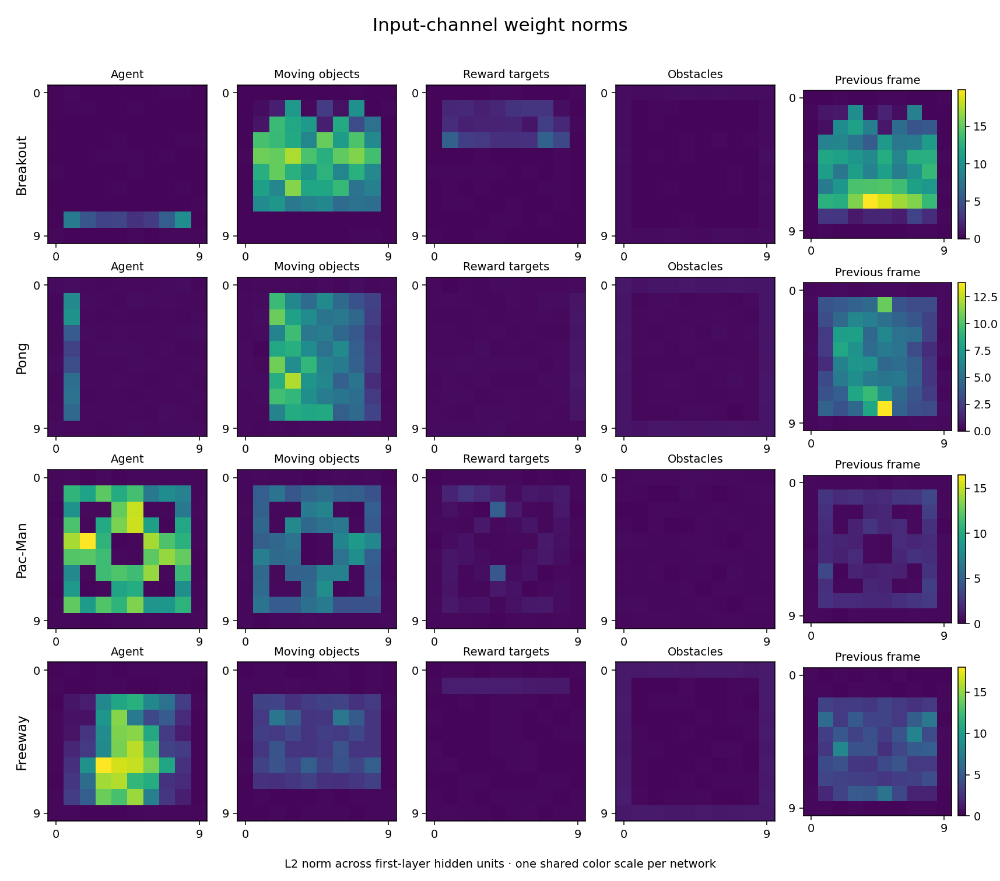

# Read weights in the Sparks game networks

Plot the first-layer connection magnitudes in the four game-policy networks released with [Sparks of Weight-Space Programming](https://rikiyat.github.io/blog/weight-space-programming/). This CPU example implements the input-channel L2-norm calculation discussed in [Sean Goedecke’s analysis](https://www.seangoedecke.com/llms-are-not-superhuman-at-reading-and-writing-neural-network-weights/).



## Run the code

```sh
python3.12 -m venv .venv-weights
source .venv-weights/bin/activate
python -m pip install -r requirements-weight-reading.txt
python weight_reading.py sparks --output results/weight-reading
```

The command downloads four 140,742-byte network files from a pinned upstream commit and verifies each SHA-256. Downloads are cached under `~/.cache/weightspaceprogramming/sparks/`. It computes 20 channel maps, checks hidden-unit permutation invariance, and writes:

- `heatmaps.png` — the four-network figure.
- `heatmaps.svg` — the scalable figure.
- `norms.json` — every map value, file hash, source URL and numerical check.

The calculation and checks run on CPU with NumPy. Matplotlib writes the figures. The command makes no model calls and requires no API key.

The [saved figure](artifacts/sparks-weight-reading/heatmaps.svg) and [numerical output](artifacts/sparks-weight-reading/norms.json) were generated from all four released files on November 23, 2026.

## What the map computes

The [original experiment](https://github.com/RikiyaT/lm_understand-logs/blob/4d09ba6d6a7e891dd8063974dfe81b3d78e3494f/exp1_which_game/README.md) uses a 10 × 10 grid with five input channels: agent, moving objects, reward targets, obstacles and previous frame. Each actor is a 500 → 32 → 32 → 5 MLP with tanh hidden layers and 17,253 parameters.

For each grid cell and input channel, the script computes:

```text
input_index = (row * width + column) * channels + channel
map[channel, row, column] = sqrt(sum_j W[input_index, j]^2)
```

`W` is `actor/dense1/kernel`, a 500 × 32 array. The sum runs across its 32 hidden units. Each value measures the magnitude of the connections from that input to the first hidden layer. Computation uses float64 accumulation on the released full-precision network arrays. The original no-tool LLM prompts contained weights rounded to three decimal places.

Each row uses one shared color scale across its five channels. Different rows have separate scales. Game names and channel labels come from the released metadata.

The agent channel shows a horizontal paddle band in Breakout, a vertical band in Pong, and the traversable maze in Pac-Man. These spatial structures explain the connection between the original weight-reading experiment and the heatmap calculation in Goedecke’s critique.

## Change a representation without changing the policy

The script permutes the 32 first-layer hidden units, applies the same permutation to their biases, and permutes the corresponding rows of the second-layer kernel. This keeps the computation connected to the same weights under a different hidden-unit ordering.

For each network it recomputes the maps and evaluates the original and permuted actors on 64 seeded binary input vectors. The recorded absolute tolerance is `1e-10`.

| Network | Maximum map difference | Maximum actor-logit difference | Check |
| --- | ---: | ---: | --- |
| Breakout | 3.55 × 10⁻¹⁵ | 7.11 × 10⁻¹⁵ | Passed |
| Pong | 1.78 × 10⁻¹⁵ | 7.11 × 10⁻¹⁵ | Passed |
| Pac-Man | 1.78 × 10⁻¹⁵ | 5.33 × 10⁻¹⁵ | Passed |
| Freeway | 3.55 × 10⁻¹⁵ | 3.55 × 10⁻¹⁵ | Passed |

All 20 maps remain unchanged within numerical precision, and all 256 actor-output comparisons pass. The binary vectors test numerical equivalence of the actor computations; they are generated by NumPy with seed 1729.

Run the regression checks for tensor layout, invalid shapes and values, cache integrity, and actor equivalence:

```sh
python -m unittest test_weight_reading.py
```

## Inspect another network

The `inspect` command accepts an NPZ kernel and an input grid shape. Inputs use height–width–channel order, and the kernel uses input-feature × hidden-unit order.

```sh
python weight_reading.py inspect network.npz \
  --key actor/dense1/kernel --shape 10 10 5 \
  --channels Agent 'Moving objects' 'Reward targets' Obstacles 'Previous frame' \
  --output results/my-network
```

Use the grid shape, channel labels and parameter key from the network’s architecture. The command rejects incompatible dimensions and non-finite or non-real kernel values.

## Sources and related code

- [Original Sparks experiment and artifacts](https://github.com/RikiyaT/lm_understand-logs/tree/4d09ba6d6a7e891dd8063974dfe81b3d78e3494f/exp1_which_game): Rikiya Takehi, Jayden Teoh, Alex Zhang and Omar Khattab.
- [Sean Goedecke’s analysis](https://www.seangoedecke.com/llms-are-not-superhuman-at-reading-and-writing-neural-network-weights/): the input-layer norm calculation and discussion of weight reading.
- [Matthew Honnibal’s experiment comparison](https://honnibal.dev/blog/astra-read-write-misleading): raw-weight access, Python and model-execution conditions for the different Sparks experiments.
- [PAW neural functions](README.md#2-compile-and-reuse-an-email-urgency-function-with-paw): PAW specifically trains a compiler to generate LoRA adapters that edit the interpreter’s weights. Compile and run an English function specification, or [try the playground](https://programasweights.com/playground).
- [Tracr compilation](README.md#1-compile-a-token-counter-with-tracr): construct transformer weights from a RASP program.

The tool was written independently. Its downloaded source networks and the resulting maps are attributed in [the artifact source record](artifacts/sparks-weight-reading/SOURCES.md).
